# Memoro Vault

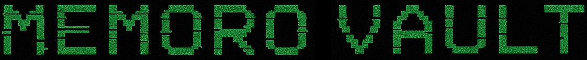

Memoro Vault is a free, offline desktop app that seals the things you most need to pass on (seed phrases, letters, document scans, photos and instructions for your family) into a single encrypted file. That file opens only for someone who can answer the personal questions you chose, so there is no account to keep alive, no server to trust and no company that can lose your data or lock your family out.

Version 1.1.0 adds a built-in file viewer and a vault editor. An open vault can now be browsed, changed and saved again without rebuilding it from scratch.

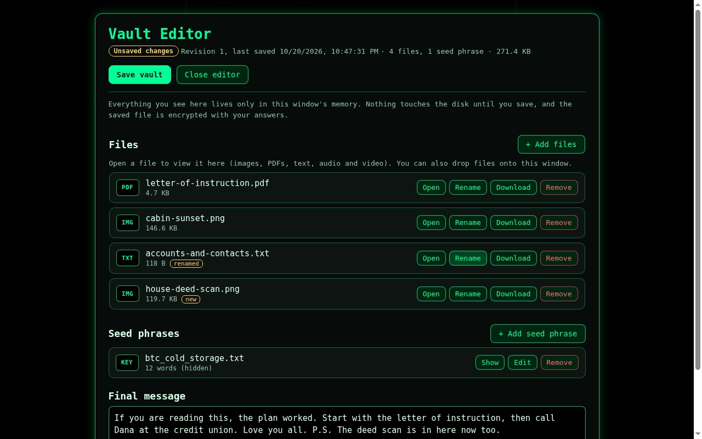

## Why it matters today

More of what people own now exists only as data. The keys to a crypto wallet, the scan of a house deed, the photos that lived on a parent's phone and the note explaining which accounts exist are usually locked behind logins tied to one person's email address, phone number and two-factor device. When that person dies or can no longer help, families often discover that the recovery codes went with the phone and that providers will not open the account. Self-custodied crypto is even less forgiving, because a lost seed phrase means the funds are gone for good.

The common workarounds move the risk somewhere else. A seed phrase written on paper in a drawer can be read by anyone who opens the drawer. A password manager or cloud folder helps only if someone can still get into it, and it depends on a company staying in business and keeping its policies. Giving a full copy to a relative or a lawyer means trusting them with everything, starting today.

Memoro Vault uses a different kind of key: knowledge that lives in the heads of the people you trust, such as family memories, old nicknames and details only they would know. Because the encrypted file is useless without those answers, you can keep copies wherever is convenient, including cloud storage, an M-DISC in a safe and a printed QR backup, and every one of them stays sealed until the right people come looking.

## How it works

You write between 4 and 25 questions and answer them. Answers are trimmed and lowercased, and they are never stored anywhere. Two of the questions become the **unlock questions**: their answers open the first layer of the vault, which holds only the questions and the hints you chose to show. Opening that layer tells a person which questions to answer, but it reveals nothing about your files.

Every remaining answer feeds the **vault key**. The answers are run through Argon2id (16 MiB of memory, 3 passes), a password-hashing function built to make each guess slow and costly even on specialized hardware. Up to six of the answers are combined in a **hidden order** that is never written down. When you recover, the app quietly tries all 720 possible orders, so you only have to know the answers, while an attacker pays up to 720 times more work for every guess.

You can also mark one question as a **red herring**. You give it a decoy answer whose length does not match the real one, and the person recovering the vault leaves it blank. Anyone attacking the vault has to treat every question as a possible decoy.

Each file is encrypted on its own with AES-256-GCM, using a separate Argon2id key derived from the answers and that file's random ID. A SHA-256 checksum of every file is stored inside the encrypted index and checked again whenever the vault is opened. If even one byte of a vault is changed, the affected part refuses to decrypt rather than handing back corrupted data.

### What is inside a vault file

| File in the ZIP | What it holds | How it is protected |
| --- | --- | --- |
| `vault.json` | Random salts and IVs, Argon2id settings and the two unlock prompts | Plain text (contains nothing secret) |
| `vault.enc` | The question list, hints and answer layout | AES-256-GCM, key from the two unlock answers |
| `vault.meta` | File names, types, checksums and a copy of the seed phrases | AES-256-GCM, key from all answers in their hidden order |
| `<random id>.vaultdoc` | One stored file each | AES-256-GCM, its own key from all answers plus the file ID |
| `README.txt`, `Vault_Builder_Instructions.txt` | Guidance for whoever finds the vault | Plain text |

Everything happens on your computer. The app blocks all network access, keeps its working storage in memory instead of on disk, and wipes the clipboard and its temporary data when you leave a vault.

## How to use it

### 1. Create a vault

Start the app, choose a theme and read the safety notes. On the dashboard, choose **Create New Vault**, pick how many questions you want, edit the questions and tick the two that will unlock the vault.

On the next page you answer every question, decide what hints to show (answer length, a few revealed letters, multiple choice or a short text hint) and, if you like, mark one red herring. The entropy meter estimates how hard your answers are to guess, so aim for the green end. This is also where you add files, seed phrases and a final message.

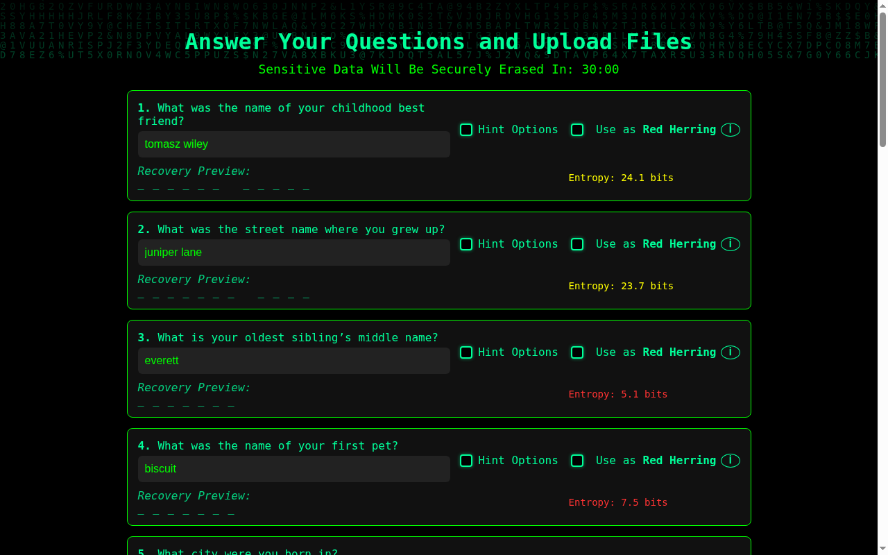

### 2. Build it and print a paper backup

Memoro seals the vault, re-opens the finished file to decrypt and check every item, and only then hands you `memoro-vault.zip`. Next it offers a paper backup: pick up to about 150 KB of the most important items (seed phrases and the final message are the usual choice) and it produces a printable PDF of QR codes that can rebuild those items even if every digital copy is lost.

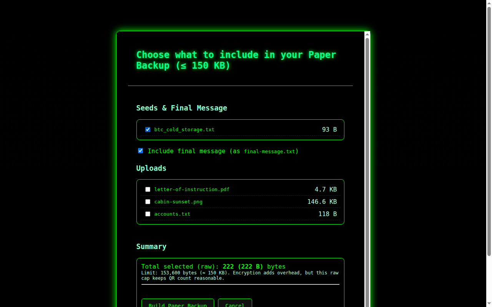

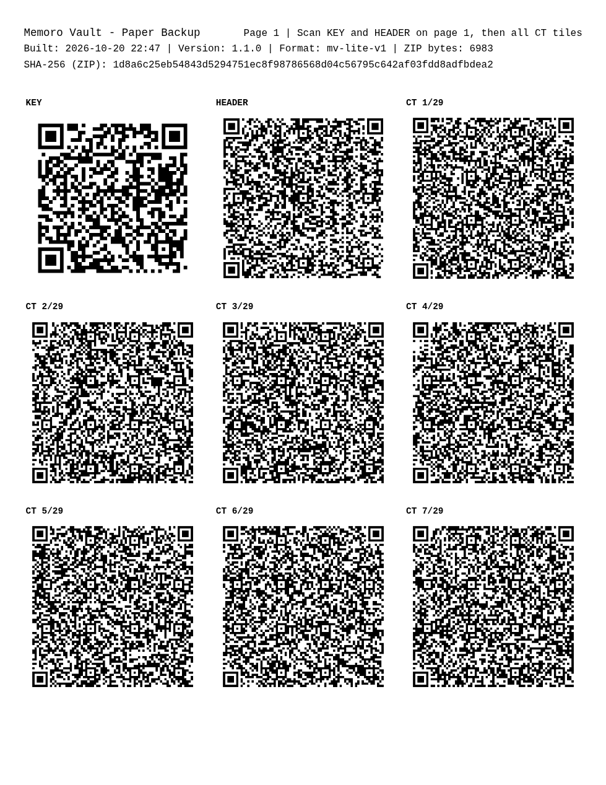

### 3. Store copies in several places

Put the vault ZIP in a folder together with the Memoro Vault installer, then copy that folder to more than one kind of storage, for example an M-DISC, an offline USB drive kept in a safe and a cloud account. Print the paper backup and store it separately. Each copy is equally sealed, so redundancy costs you nothing in security.

### 4. Open the vault later

On the dashboard choose **Load Vault File**, select the ZIP and press **Unlock Vault**. Answer the two unlock questions, then answer the rest on the recovery page (leave the red herring blank). The app works out the hidden order by itself.

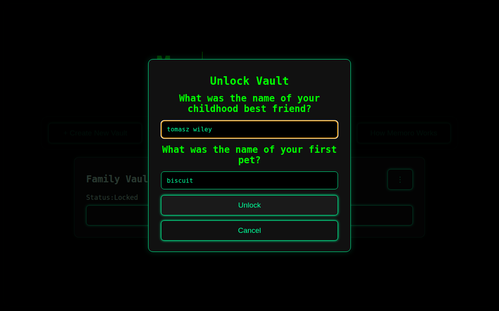

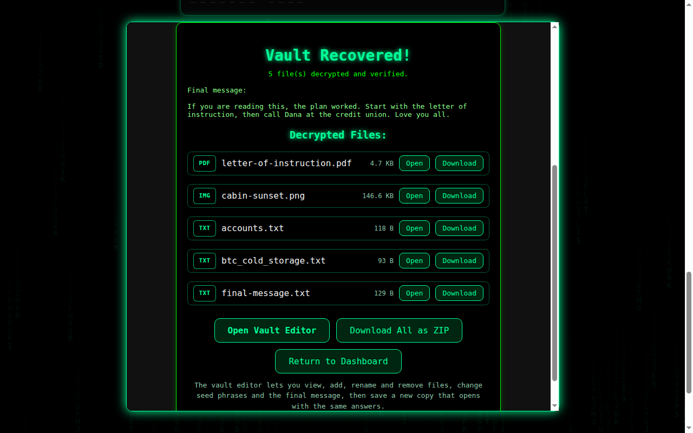

### 5. View files without saving them

Use **Open** to look at a file inside Memoro Vault. Images, PDFs, text, audio and video are shown straight from memory, so you can read a document or check a photo without writing a decrypted copy to disk. Inside the vault editor, text files can also be edited in place.

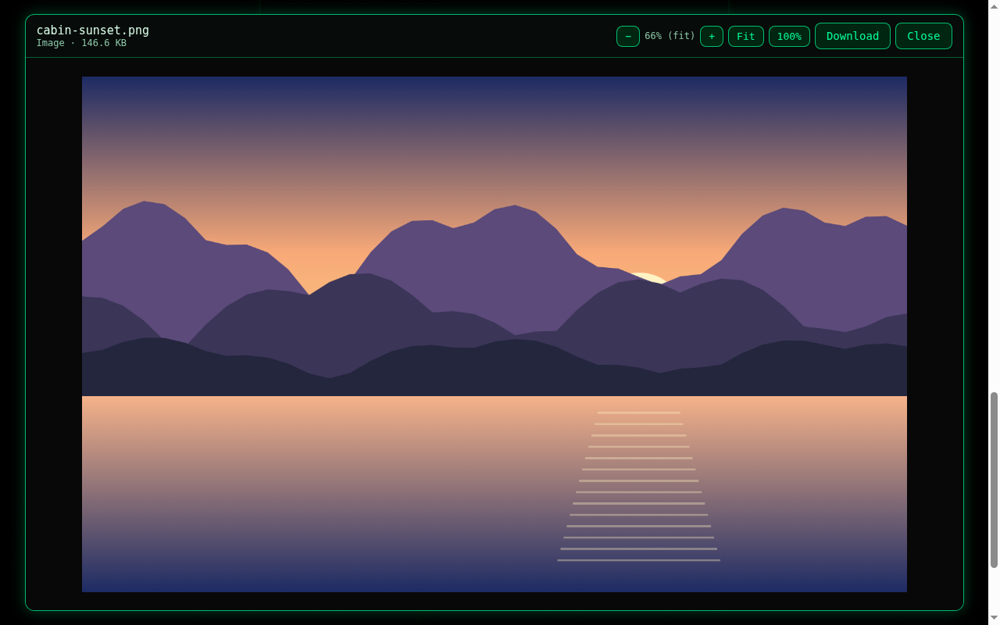

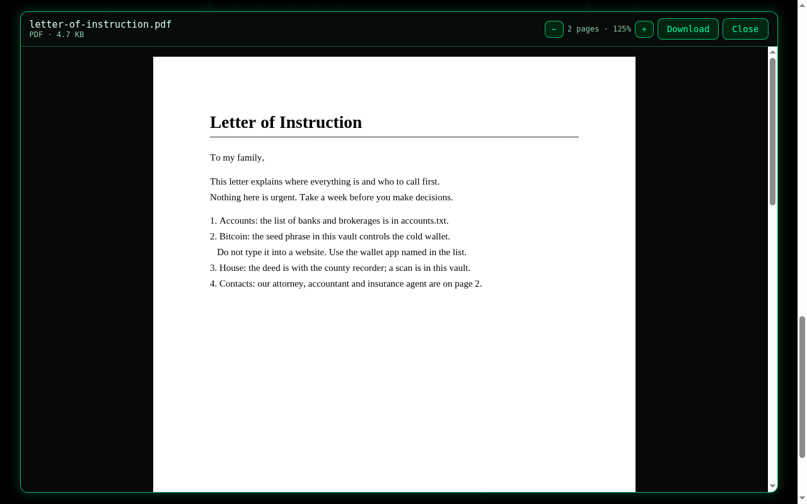

### 6. Edit the vault and save it again

Choose **Open Vault Editor** to add, rename or remove files, add or change seed phrases (they stay hidden until you press Show) and rewrite the final message. You can also drop files straight onto the editor.

When you save, the app lists your changes, seals a new vault with the same questions and answers, and re-opens the new file to verify every item before asking where to save it. Your edits only count as saved once the file has actually been written, so cancelling the save dialog never loses anything. Every save uses fresh salts, fresh encryption keys for each file and a new hidden answer order, so no salt, key or ciphertext is ever reused between versions. You can make a new paper backup in the same step.

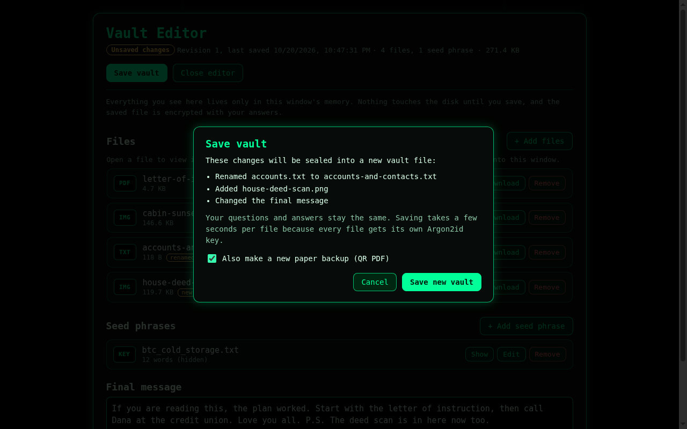

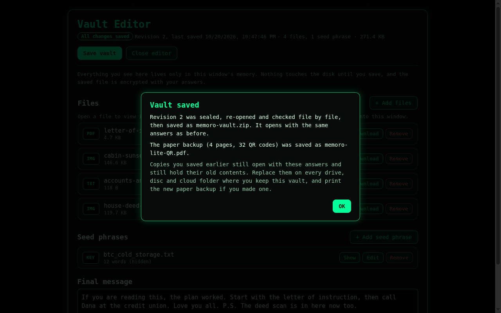

Copies you saved earlier still open with the same answers and still contain their old contents. After saving, replace the vault everywhere you keep it and reprint the paper backup if it changed.

The Clean theme gives the same tools a quieter look:

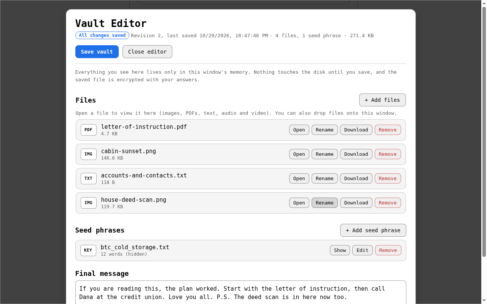

## Security notes

- **Offline by design:** network requests are blocked, a strict Content-Security-Policy is applied to every page, and pop-ups and navigation outside the app folder are refused.
- **Nothing sensitive on disk:** since 1.1.0 all app storage (answers in progress, uploaded files, the unlock hand-off) lives in an in-memory session. Earlier versions kept that data in the browser profile on disk, and the first launch of 1.1.0 overwrites and deletes whatever they left there.
- **Strong randomness:** every salt, IV, file ID, question shuffle and hidden order comes from the operating system's cryptographic random number generator, using unbiased sampling.
- **Verified writes and reads:** new and edited vaults are re-opened and fully decrypted before you receive them, and every recovered file is checked against its SHA-256 checksum.
- **Nothing secret on screen:** the recovery progress display never shows your answers or anything derived from them.
- **Current runtime:** the app runs on Electron 44, and release builds disable Node.js debugging switches and `ELECTRON_RUN_AS_NODE`.

Memoro Vault cannot protect a vault from malware or a keylogger running on the computer while it is open, from answers that are easy to guess, or from someone who genuinely knows all of the answers. For seed phrases and private keys, open vaults on an offline machine or a freshly booted Tails session, and type rather than paste secrets.

## Compatibility

Vaults created or edited with 1.1.0 use the same format as 1.0.8, so they open in any release from 1.0.8 on, and vaults made with 1.0.8 can be opened and edited in 1.1.0. Release builds are produced for Windows 10 and later, macOS 13 (Ventura) and later, and 64-bit Linux (AppImage, deb and rpm).

## Verifying a download

Every release on the [Releases](https://github.com/Kasmaristo-Delvakto/memoro-vault/releases) page includes a `SHA256SUMS.txt` file listing the SHA-256 checksum of each download, and signed releases also include `.asc` signatures. On Linux you can check a download by running `sha256sum -c SHA256SUMS.txt --ignore-missing` in the folder where you saved it; on macOS use `shasum -a 256` and compare the result with the published value.

## Building from source

```bash
npm ci
npm start                 # run the app
npm test                  # vault format, compatibility, entropy and tamper tests
xvfb-run -a npm run test:e2e   # full app flows in Electron (drop xvfb-run on a desktop)
npm run build:linux       # or build:win / build:mac
```

Setting `MV_LEGACY_APP=/path/to/a/1.0.8/checkout` before `npm run test:e2e` also checks, in both directions, that vaults move between this version and that older release. `npm run screenshots` regenerates the images in this README from sample data.

The Rust source for the WebAssembly crypto module (Argon2id, AES-256-GCM, SHA-256) lives in `rust/memoro-crypto`.

## License

Memoro Vault is released under the GNU General Public License v3.0. See [LICENSE](LICENSE).

> Libereco ne estas donaco. Ĝi estas devo.
>
> Kaŝmaristo Delvakto
